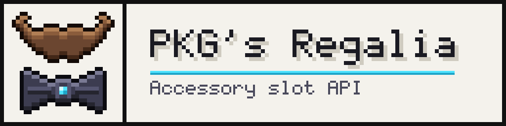

<p align="center">
  
</p>

<p align="center">
  <a href="https://discord.com/invite/SYq48RNu3K"></a>
  <a href="CURSEFORGE_LINK"></a>
</p>

# PKG's Regalia

**An accessory slot API for Minecraft 1.21.1 (NeoForge).** Fabric support is planned.

Regalia adds extra equipment slots for helmets, chestplates, leggings, boots and an elytra, with an inventory screen you can customize. Other mods can make their items wearable through a small API.

This repository contains the **documentation, assets and example mod** for Regalia. The mod's source code is not hosted here.

---

## Features

- **Extra slots** for helmets, chestplates, leggings, boots and elytra
- **Two menus:** a compact *Basic* panel next to the vanilla inventory, and an *Advanced* screen opened with a keybind (scrollable slot list, dark / light theme)
- **Visible accessories:** worn items are rendered on the player
- **API for developers:** make your items equippable and add your own behavior
- **Tag-based slots:** decide which items fit a slot with plain item tags, no code needed

## Compatibility

| | |
|---|---|
| Minecraft | 1.21.1 |
| Loader | NeoForge (Fabric planned) |

## Using Regalia in your mod

1. Add Regalia as a dependency in your `neoforge.mods.toml`:

```toml
[[dependencies.yourmodid]]
modId="regalia"
type="required"
versionRange="[1.0,)"
ordering="AFTER"
side="BOTH"
```

2. Add Regalia to your development environment. Build setup instructions are provided with the example mod.

3. Put your item into a slot with an item tag. For example, to allow an item in the elytra slot:

`data/regalia/tags/item/accessories/elytra.json`
```json
{
  "replace": false,
  "values": [
    "yourmodid:your_wings"
  ]
}
```

Full API documentation is coming soon.

## Repository contents

```
assets/          Banner, icon and screenshots
docs/            Documentation
example-mod/     Example NeoForge mod using Regalia (coming soon)
```

## Roadmap

- [ ] Example mod
- [ ] API documentation
- [ ] Fabric version

## Support

Questions, bug reports and suggestions are welcome on our [Discord](https://discord.com/invite/SYq48RNu3K).

## License

The documentation and example code in this repository are licensed under the [Apache License 2.0](LICENSE).

The Regalia mod itself is distributed separately through CurseForge under its own license terms.

*Minecraft is a trademark of Mojang AB. This project is not affiliated with or endorsed by Mojang or Microsoft.*

Made by PoyrazPKG and KayraPKG.
